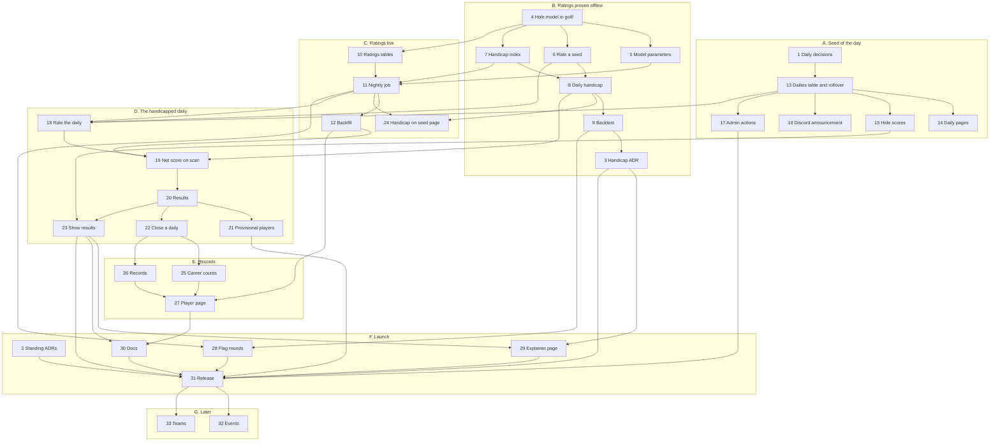

# Competitive play: implementation plan

> **Note**: This document was written by Claude, from a design session with jdharms on
> 2026-11-12. It orders the work that takes [design.md](design.md) to production. Nothing
> in it is built.

Tasks are numbered for reference, not strictly in the order to do them: the
prerequisites and the graph give the order. Every task that adds a page leaves its
English to jdharms (`server/CLAUDE.md`, "Player-facing text").

## Tasks

### Decisions

| # | Task | Needs |
|---|------|-------|
| 1 | Settle the daily's open questions in `design.md`: the day's start and end, whether dailies overlap, the generation recipe, bag rules. Record them as a proposed ADR | - |
| 2 | Record the standing decisions as proposed ADRs: competition lives on the site; the daily is the unit and there are no seasons; no handicap leaderboard; scores hidden until a player submits | - |
| 3 | Record the handicap rules as a proposed ADR once task 9 has set the numbers: last 8 rounds, the allowance, the caps, the provisional period, which rounds count | 9 |

### Ratings engine

| # | Task | Needs |
|---|------|-------|
| 4 | Move the hole model out of `tools/spikes/` into `golf/`: the fit with the spread term, taking rounds and seed holes as plain data, with unit tests on synthetic rounds | - |
| 5 | Estimate the model's variance components and the spread coefficient offline, and store them as a checked-in parameters file the nightly fit reads | 4 |
| 6 | Rate a seed from fitted hole ratings: course rating, slope and stroke indexes, with the baseline fallback for a hole nobody has played | 4 |
| 7 | Compute a handicap index from a player's rounds: the last 8, the net double bogey cap, the low mark and its caps, the provisional state, and which rounds count: daily rounds, plus the rounds a current player's index is seeded from | 4 |
| 8 | Compute a daily handicap and its strokes per hole from an index, a seed's ratings and the allowance, including a player better than scratch | 6, 7 |
| 9 | A maintained backtest (`golf-ratings backtest`) that replays a site database through tasks 6 to 8 day by day, using only what was known each day. Use it to set the numbers, test the caps and the daily-rounds-only rule, and set the integrity threshold | 8 |

### Ratings on the site

| # | Task | Needs |
|---|------|-------|
| 10 | Tables for a ratings run, its hole ratings, and each player's index history by day (index, low mark, rounds counted, provisional) | 4 |
| 11 | The nightly ratings job: read rounds, fit, write a run and every player's index. A systemd timer in `deploy/`, described in `docs/deployment.md` | 5, 7, 10 |
| 12 | Seed each current player's index from all of their recorded rounds on any seed, so the first daily has handicaps. After it, only daily rounds are added | 11 |

### The daily

| # | Task | Needs |
|---|------|-------|
| 13 | A `dailies` table (date, seed, opens, closes) and the job that generates the day's seed at rollover from the recipe. Idempotent, so a missed run catches up | 1 |
| 14 | The daily on the site: today's daily on the home page, its own route, and an archive of past dailies | 13 |
| 15 | Hide a daily's scores from a viewer who has not submitted a round on it: the seed page, other players' round pages, `/me` and link preview cards | 13 |
| 16 | Announce a new daily to Discord by webhook, with no scores | 13 |
| 17 | Admin actions for a daily: replace a broken seed, withdraw a day. Through the audit log | 13 |

### Handicapped results

| # | Task | Needs |
|---|------|-------|
| 18 | At rollover, store the daily's course rating, slope and stroke indexes, and the ratings run they came from | 6, 11, 13 |
| 19 | When a scan records a round on an open daily, store the player's daily handicap, net score by hole and Stableford points | 8, 12, 18 |
| 20 | Compute a daily's results under each format: the Stableford standing, every pair's match, and net skins across the field. Formats are separate functions of the field's net scores, so one can be added later. Recomputed when a round arrives, is voided or is restored | 19 |
| 21 | Provisional players: shown their own results, left out of the standing, skins and other players' records | 20 |
| 22 | Close a daily: fix its results and its winner. A round received later is an ordinary round | 20 |
| 23 | Show results: a player's net card with strokes received, their matches, the standing and the skins, on the round page and the daily's page, only to players who have submitted | 15, 20 |
| 24 | Show a signed-in player their handicap for any seed on its page, before they play | 8, 11 |

### Records

| # | Task | Needs |
|---|------|-------|
| 25 | Career counts for each player: dailies played, daily wins, match record, skins won, birdies and eagles, rounds under handicap. Counts only, kept current as dailies close and rounds are voided | 22 |
| 26 | Head-to-head and against-the-field records, for a career and by month | 22 |
| 27 | A player's page: index and low mark with their history, career counts and records. Decide whether it is public | 12, 25, 26 |

### Integrity

| # | Task | Needs |
|---|------|-------|
| 28 | Flag a round far better than the model expected for admin review, at the threshold task 9 sets, using the existing flag and void actions | 9, 11 |

### Launch

| # | Task | Needs |
|---|------|-------|
| 29 | A document page on the site explaining handicaps and the daily's formats; jdharms writes it | 3, 23 |
| 30 | Bring the docs up to date: `server/CLAUDE.md`, the data model and routes in `docs/randomizer_devplan.md`, `docs/README.md`, and the spike's README entry once the model has moved | 23, 27 |
| 31 | Release: migrations on production, the backfill, release notes, the ADRs accepted on merge | 2, 3, 17, 21, 23, 28, 29, 30 |

### Later

| # | Task | Needs |
|---|------|-------|
| 32 | Short opt-in events: several dailies as one tournament, handicaps frozen at its start | 31 |
| 33 | Teams: a daily's field paired for net best ball, or a month between two balanced sides | 31 |

## Milestones

| Milestone | Tasks | What works |
|-----------|-------|------------|
| A. Seed of the day | 1, 13, 14, 15, 16, 17 | The site generates a daily, shows it, announces it and hides its scores from players who have not played. No handicaps. This answers the players' request and can ship first |
| B. Ratings proven offline | 4, 5, 6, 7, 8, 9, 3 | Handicaps for every player and every seed can be computed from a database copy, and the numbers are set by backtest |
| C. Ratings live | 10, 11, 12, 24 | Every player has an index that updates nightly, and sees their handicap for any seed |
| D. The handicapped daily | 18, 19, 20, 21, 22, 23 | A daily round produces a net card, a standing, a match against everyone else in the field, and skins |
| E. Records | 25, 26, 27 | Career counts, head-to-head and monthly records, and a player's page |
| F. Launch | 2, 28, 29, 30, 31 | Flagging, the explainer, docs and the release |
| G. Events and teams | 32, 33 | Formats layered on the daily |

A and B share no tasks and can go on side by side. C needs B. D needs A and C. E needs
D.

## Dependency graph

